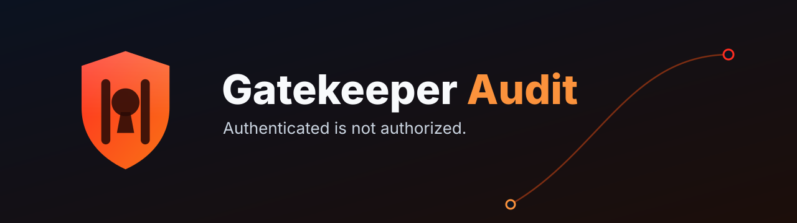

<p align="center">
    
</p>

# Gatekeeper Audit

[](https://github.com/usamamuneerchaudhary/gatekeeper-audit/actions/workflows/slipway.yml)
[](https://packagist.org/packages/usamamuneerchaudhary/gatekeeper-audit)
[](LICENSE.md)

Gatekeeper Audit inspects the routes your Laravel application actually registers and reports authenticated endpoints that accept an object but show no object-level authorization check. It also flags lookups on user or tenant owned models that are not scoped through the authenticated user.

Broken Object Level Authorization (BOLA, also called IDOR) is the top API security risk in the OWASP API Security Top 10. Authentication proves who a user is. It does not prove that the user may view or change the invoice in `/invoices/42`. That second check is the one this package looks for.

## The problem

This route is authenticated, and it is still broken:

```php
Route::middleware('auth')->group(function () {
    Route::put('/invoices/{invoice}', [InvoiceController::class, 'update']);
});
```

```php
public function update(UpdateInvoiceRequest $request, Invoice $invoice)
{
    $invoice->update($request->validated());
}
```

Any signed-in user can change any invoice by changing the id. A role check does not fix it either: `role:admin` says something about the user, nothing about this invoice. Gatekeeper Audit reports the difference.

```
[HIGH] PUT invoices/{invoice} object_authorization
  App\Http\Controllers\InvoiceController@update (app/Http/Controllers/InvoiceController.php:14)
  Authenticated route accepts an object but shows no object-level authorization check.
  - middleware role:admin is role or class level, not object level
  - no object-level authorize, Gate, can middleware, or FormRequest check was found
```

Any of these clear the finding:

```php
$this->authorize('update', $invoice);
```

```php
Route::put('/invoices/{invoice}', ...)->middleware('can:update,invoice');
```

```php
// UpdateInvoiceRequest
public function authorize(): bool
{
    return $this->user()?->can('update', $this->route('invoice')) ?? false;
}
```

## Installation

Install it as a development dependency:

```bash
composer require --dev usamamuneerchaudhary/gatekeeper-audit
```

Publish the configuration if you want to change the defaults:

```bash
php artisan vendor:publish --tag=gatekeeper-config
```

## Usage

```bash
php artisan gatekeeper:audit
```

The command boots your application and reads the registered route table, the same way `route:list` does. Run it in the testing environment in CI so it never touches production data. It only reads code and route definitions.

Useful options:

| Option | What it does |
| --- | --- |
| `--fail-on-unauthorized` | Fail CI on high and medium authorization and scoping findings. |
| `--fail-on=medium` | Choose the severity that fails the run. Default is `high`. |
| `--no-fail` | Print the report and always exit `0` after a successful run. |
| `--format=json` | Emit the versioned JSON report (`gatekeeper.report.v1`). |
| `--format=github` | Emit GitHub Actions workflow annotations. |
| `--format=sarif` | Emit SARIF 2.1.0 for code scanning. |
| `--only=api/invoices` | Audit only URIs with this prefix. |
| `--include-public` | Also audit routes without auth middleware. |
| `--include-vendor` | Also audit vendor routes. |
| `-v` | Explain passed, skipped, and suppressed routes. |

Exit codes: `0` means no finding crossed the failure threshold, `1` means at least one did, and `2` means the audit itself could not run.

### CI

```yaml
- name: Authorization audit
  run: php artisan gatekeeper:audit --format=github --fail-on-unauthorized
  env:
    APP_ENV: testing
```

### Baseline an existing application

A large application will have findings on the first run. Record them, then fail on anything new:

```bash
php artisan gatekeeper:baseline
php artisan gatekeeper:audit --fail-on-unauthorized
```

The baseline file (`gatekeeper-baseline.json` by default) stores stable finding ids that do not depend on line numbers, so unrelated edits do not invalidate it. `php artisan gatekeeper:audit --prune-baseline` rewrites the file to the current finding set and lists stale ids.

## What counts as an object-level check

- `$this->authorize('update', $invoice)`, `Gate::authorize(...)`, `Gate::allows(...)`, or a `->can('update', $invoice)` call that receives the routed model.
- Route middleware `can:update,invoice`, where the second argument is the route parameter. `can:update,App\Models\Invoice` is class level and does not clear a bound invoice.
- `authorizeResource(Invoice::class, 'invoice')`, or middleware declared through the `HasMiddleware` contract.
- A FormRequest `authorize()` method that references the routed model, for example through `$this->route('invoice')`.

What never clears an object route: `auth` middleware alone, Spatie `role` or `permission` middleware, `authorize('viewAny')` without the instance, a FormRequest `authorize()` that returns `true` or only checks that a user is signed in, and a policy method that only returns `true`.

## What counts as a scoped lookup

The scoping rules only apply to models that belong to a user or tenant: models listed in `gatekeeper.ownership.models`, or models whose source shows a `belongsTo` relation or a relation named `user`, `owner`, `tenant`, `team`, or `account`.

Scoped, and not flagged:

```php
$request->user()->invoices()->findOrFail($id);
Invoice::where('user_id', auth()->id())->findOrFail($id);
```

Flagged:

```php
Invoice::findOrFail($id);
Invoice::query()->get();
DB::table('invoices')->find($id);
```

Models protected by a global scope are suppressed rather than flagged, because the scope may already constrain every query. Set `gatekeeper.ownership.flag_global_scopes` to `true` if you want those reported anyway. Scoped route bindings (`->scopeBindings()`) cover the injected parameter only; a raw `Invoice::findOrFail($id)` in the same action is still flagged.

## Rules

| Rule | Severity | Meaning |
| --- | --- | --- |
| `object_authorization` | High | An authenticated object route shows no object-level check. |
| `trivial_form_request` | High or Medium | A FormRequest `authorize()` returns `true`, is missing, or only proves a user is signed in. |
| `trivial_policy` | High | A policy runs, but the relevant method or `before()` only returns `true`. |
| `missing_authorization` | Medium | A state-changing route shows no authorization of any kind. |
| `unscoped_lookup` | Medium, or Low when an object check exists | A lookup on an owned model is not scoped through the authenticated user. |
| `unscoped_collection` | Medium | A collection query on an owned model has no owner or tenant constraint. |
| `unparsed_action` | Low | The action source could not be parsed, so no check could be confirmed. |

## Limits

Read these before trusting a clean run:

- A finding means "no authorization signal was found", not "this endpoint is exploitable". A check can live in a place static analysis cannot see, and a reported route still needs a human to confirm reachability.
- This is not a substitute for policy tests. Test that user A receives a `403` or `404` for user B's record.
- Livewire component actions and Filament panel routes are not scanned in this version. They are listed as skipped in verbose mode.
- Global scopes are trusted by default. If a global scope does not actually constrain by owner or tenant, enable `ownership.flag_global_scopes`.
- Analysis follows one level of private method calls in the same controller and reads application traits. Dynamic calls and checks hidden behind service classes may be missed.
- Public routes are skipped by default, because many are intentionally public.

## Configuration

The published `config/gatekeeper.php` controls which middleware counts as authentication, which middleware is role level, permanently ignored routes and controllers, ownership relations and columns, models to always treat as owned or never owned, and the baseline path.

## Brand assets

<picture>
    <source media="(prefers-color-scheme: dark)" srcset="public/assets/logo-dark.svg">
    
</picture>

Logos and cards live in [public/assets](public/assets). Use them in docs, blog posts, and directory listings, and keep the shield mark and wordmark unchanged.

| File | Use |
| --- | --- |
| `logo.svg` / `logo-dark.svg` | Wordmark for light and dark backgrounds. |
| `logo-mark.svg` / `logo-mark.png` | Shield mark on its own, for avatars and icons. |
| `banner.svg` / `banner.png` | README and documentation header. |
| `social-card.svg` / `social-card.png` | Open Graph and social sharing image (1280 x 640). |

## Testing

```bash
composer test
```

## Security

Report vulnerabilities through the [GitHub security advisory](https://github.com/usamamuneerchaudhary/gatekeeper-audit/security/advisories/new) form rather than a public issue.

## License

The MIT License. See [LICENSE.md](LICENSE.md).
